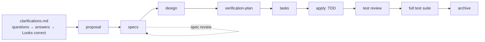

# sdd-kit

[](https://github.com/cmdtorch/sdd_kit/actions/workflows/test.yml)
[](https://github.com/cmdtorch/sdd_kit/releases)
[](LICENSE)

Spec-Driven Development for small teams on **OpenSpec + Claude Code**, for any stack.

Teams that hand vague client requirements straight to an AI agent get code that does what the agent guessed.
That means bugs for manual QA and rework. sdd-kit puts a structured, checked process around OpenSpec:

1. **Questions before code.** The agent asks structured clarifying questions before every planning artifact.
   Every question is written so it can be forwarded as is to whoever knows the answer. The answers are analysed
   for vagueness and contradictions and confirmed with an explicit "Looks correct". A hook blocks the next
   artifact until that happens.
2. **Grounded artifacts.** Every statement in the proposal and design cites the answer or source it comes from.
   Assumptions are labelled.
3. **Tests that prove scenarios.** Every spec scenario is planned at a verification level (`unit`,
   `integration` or `manual`) and tested by a test that carries its marker — a plain comment, in any language.
   A test reviewer asks of every test: "would this fail if the feature broke?". Apply uses TDD.
4. **Hard guarantees.** Claude Code hooks enforce the rules while you work: no artifact before its answers are
   confirmed, no archive before tasks, markers and the test review are done.

The kit knows nothing about your stack: it never runs your tests and has no presets. The agent uses the
project's own commands.



## Requirements

| | |
|---|---|
| Node.js | ≥ 20 |
| OpenSpec CLI | **1.15.0** exactly (`npm i -g @fission-ai/openspec@1.15.0`) |
| Claude Code | any current version |
| git | the kit finds test markers through git |
| OS | Linux, macOS, WSL (native Windows is not supported) |

No other dependencies: the kit is plain Node.js.

## Quick start

**Team lead, once per repository:**

```bash
npm i -g @fission-ai/openspec@1.15.0
npx github:cmdtorch/sdd_kit#v0.4.0-beta.1 install --dry-run   # show the plan, write nothing
npx github:cmdtorch/sdd_kit#v0.4.0-beta.1 install             # asks for the questions language, nothing else
git add -A && git commit -m "chore: install sdd-kit 0.3.0"
```

Make sure `CLAUDE.md` or the README of your project says how to run the tests and quality checks. Details:
[docs/guide/install.md](docs/guide/install.md).

**Every developer** (the kit is already committed):

1. Install Node 20+, Claude Code and `npm i -g @fission-ai/openspec@1.15.0`.
2. Clone the repository and run `node openspec/tooling/bin/doctor.mjs`.
3. Open Claude Code in the repository and accept the workspace trust dialog.

## Daily work

```
/opsx:new <change-name>      start a feature (schema clarify) and its first question round
/opsx:continue               next artifact (each one starts with its own question round)
/sdd:clarify                 continue or add questions for the current stage
/opsx:apply                  implement with TDD; finish with the test review and the full suite
openspec archive <change>    when everything is done (the archive gate checks)
```

The walkthrough, including small changes (`lean`), is in [docs/guide/workflow.md](docs/guide/workflow.md).

Useful commands in a project:

| Command | What it does |
|---|---|
| `node openspec/tooling/bin/doctor.mjs` | is this machine/repository ready? what to fix |
| `node openspec/tooling/checks/check-traceability.mjs --change <c> --markers` | every planned scenario has a marked test |
| `node openspec/tooling/bin/review-input.mjs --change <c>` | scenarios, THEN clauses and marked tests (what the test reviewer reads) |
| `node openspec/tooling/bin/openspec.mjs update` | `openspec update` with the kit's workflow profile (never run it plainly) |

## What it adds to your repository

| Path | What |
|---|---|
| `openspec/protocols/` | the rules the agent follows: questions, grounding, testing, reviews |
| `openspec/schemas/clarify/`, `openspec/schemas/lean/` | the kit workflows, forked from OpenSpec's `spec-driven` |
| `openspec/tooling/` | checks, hooks and tools (Node.js scripts, no dependencies) |
| `openspec/config.yaml` | a marked kit block in `context`; `clarify` becomes the default schema |
| `.claude/settings.json` | the kit hooks and read-only permissions, merged with yours |
| `.claude/agents/`, `.claude/commands/sdd/` | the spec and test reviewers, `/sdd:clarify` |

The installer keeps a hash manifest: updates never overwrite files you edited, and `uninstall` restores
`config.yaml`, `settings.json` and `.gitignore`.

## Limitations

- **Claude Code only.** Other agents (Cursor, Codex, …) are not supported.
- **OpenSpec is pinned.** Each kit version supports exactly one OpenSpec version; doctor and session start
  warn on a mismatch.
- **Browser E2E only for web applications in a monorepo**, with Playwright for JavaScript and Chromium only;
  no backend → frontend contract step yet ([decisions](docs/decisions.md) R7, R26).
- The kit runs only the E2E tests, through its own script; for every other test it relies on the agent
  using the commands your project documents.

## Documentation

- [How it works: what the kit adds to OpenSpec](docs/how-it-works.md)
- [Install, update, uninstall, onboarding](docs/guide/install.md)
- [Daily workflow](docs/guide/workflow.md)
- [Decisions](docs/decisions.md), [verified OpenSpec and Claude Code facts](docs/openspec-facts.md),
  [changelog](CHANGELOG.md), [roadmap](docs/roadmap.md)
- [Contributing](CONTRIBUTING.md), [security](SECURITY.md)

## License

[MIT](LICENSE)
